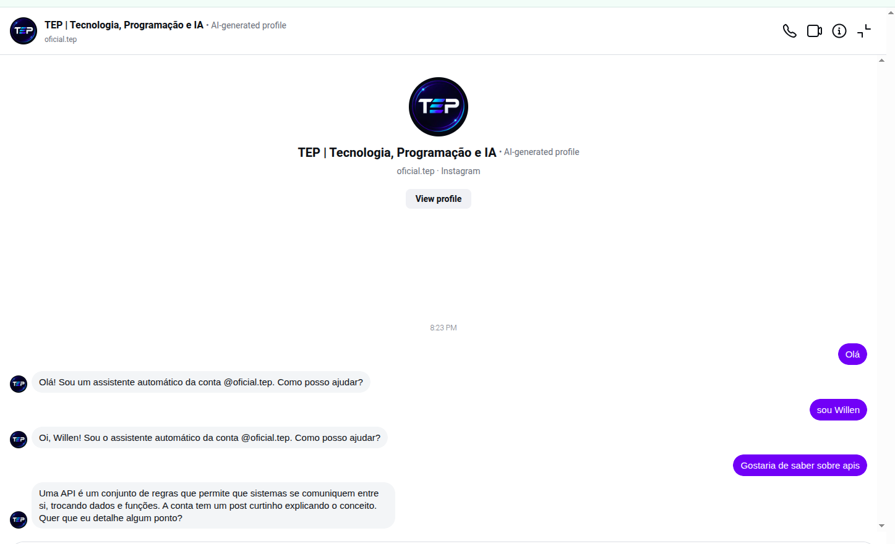

# AULA 12 - N8N

## Detalhes

**Disciplina:** TÓPICOS ESPECIAIS EM PROGRAMAÇÃO

**Docente:** BENEVID FELIX DA SILVA

**Discentes:**
* CAMILA WEBER - camila.weber@unemat.br
* VITOR EMANUEL S. SAUZEN - vitor.sauzen@unemat.br
* WILLEN SILVA DE SOUZA - willen.silva@unemat.br

**LINK DO GIT:** https://github.com/WillenSouza/aula-n8n/tree/main/aula12

**LINK DA PUBLICAÇÃO:** https://www.instagram.com/reel/DfTRNS6NQnJ/

## Resultados

### Resposta automática a comentário

Um comentário feito por outra conta no reel da conta @oficial.tep ("Onde encontro o material?") foi respondido automaticamente pelo workflow do n8n. A resposta vem da tabela de palavras-chave (regra `material`) e termina com "(resposta automática)", identificando que foi enviada por um programa.

### Resposta automática no Direct

Conversa no Direct com a conta @oficial.tep. O agente, que usa o modelo DeepSeek, se apresenta como assistente automático na primeira resposta, usa o nome informado pela pessoa ("sou Willen") e responde à pergunta sobre APIs com base no que sabe sobre a conta.

